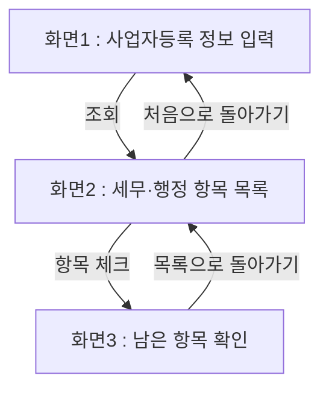

# PRD — 사업자등록 정보 입력
- 상태 : 완성
- 한 줄 정의 : 사업자등록한 지 1개월 된 IT 서비스 개발업 1인 창업자가 업종과 등록일을 넣으면 그 업종에 맞는 세무·행정 항목 목록이 나와서, 선배나 세무사에게 묻지 않아도 무엇을 해야 하는지 알 수 있다.

## 1. 문제

### 배경
사업자등록을 막 마친 1인 창업자는 사업 경험이 없어서 어떤 세무·행정 절차를 해야 하는지 자체를 모른다. 지금은 주위에 창업한 선배들에게 물어보거나 세무사 등에게 문의하는 방식으로 이 문제를 해결하고 있다.

### 목표
사업자등록 정보(업종, 등록일)를 입력하면 그 업종에 맞는 세무·행정 항목 목록이 자동으로 뜨게 하여, 사용자가 선배나 세무사에게 묻지 않아도 스스로 무엇을 해야 하는지 알 수 있게 한다.

## 2. 사용자

### 페르소나
- 누구인가 : 사업자등록한 지 1개월 된, IT 서비스 개발업 1인 창업자
- 언제 : 사업자등록을 막 마친 직후
- 왜(문제) : 사업 경험이 없어서 어떤 세무·행정 절차를 해야 하는지 자체를 모름
- 지금은 어떻게 : 주위 창업한 선배들에게 물어보거나 세무사 등에게 문의함

### 사용자 스토리
- 사업자등록한 지 1개월 된 IT 서비스 개발업 1인 창업자로서, 업종과 사업자등록일을 입력하면 그 업종에 맞는 세무·행정 항목 목록을 보고 싶다. 사업 경험이 없어 어떤 절차를 해야 하는지 몰라서, 선배나 세무사에게 묻지 않고도 스스로 알고 싶기 때문이다.
- 사업자등록한 지 1개월 된 IT 서비스 개발업 1인 창업자로서, 완료한 항목을 체크하고 싶다. 아직 안 한 항목만 한눈에 남아서 무엇을 더 해야 하는지 쉽게 확인하고 싶기 때문이다.

## 3. 범위

### 넣을 기능
1. 사업자등록 정보(업종, 등록일)를 입력하면 → 그 업종에 맞는 세무·행정 항목 목록이 자동으로 뜬다(핵심)
2. 항목을 하나씩 완료 체크하면 → 아직 안 한 항목만 남아서 한눈에 보인다
3. 항목 자료에 없는 업종을 입력하면 → AI가 항목 자료에 있는 업종 가운데 가장 비슷한 업종을 찾아 "이 업종으로 볼까요?" 하고 물어본다

### 기능 요구사항
1. 업종과 사업자등록일을 입력하고 "조회" 버튼을 누르면 → 그 업종에 맞는 세무·행정 항목 이름만 나열된 목록(예상 5~7개)이 화면에 뜬다.
2. 목록에서 항목을 체크하면 → 그 항목이 목록에서 빠지고, 아직 체크하지 않은 항목만 남아서 보인다.
3. 업종마다 해야 할 항목이 일부 다를 수 있다.
4. 화면2에 뜨는 항목은 사업자등록일을 기준으로 계산된다.
5. 항목 자료에 없는 업종으로 "조회" 버튼을 누르면 → 화면2에 AI가 고른 비슷한 업종과 함께 "네"/"아니요" 버튼이 뜬다. AI는 항목 자료에 이미 있는 업종 가운데서만 고르고, 세무·행정 항목을 새로 만들지 않는다.
6. AI가 비슷한 업종을 찾지 못하거나 AI를 쓸 수 없으면 → 질문 없이 "항목 자료가 아직 없어요" 안내 문구가 뜬다.

### 비목표
- 부가세 신고 등 마감일이 다가오면 달력에 체크리스트로 표시되는 기능 — 까닭 : 핵심 기능에 집중
- 체크리스트의 각 항목을 클릭하면 무엇을, 왜 해야 하는지 쉬운 설명이 나오는 기능 — 까닭 : 핵심 기능에 집중
- 사업자등록 직후 첫 1년 동안 해야 할 절차를 순서대로 정리해 보여주는 기능 — 까닭 : 다음 단계 기능
- 신규 창업자가 자주 놓치는 절차를 모아서 보여주는 기능 — 까닭 : 다음 단계 기능

## 4. 화면

### 사용자 흐름
- 화면1 — 사업자등록 정보 입력 : 업종과 사업자등록일을 입력하고 "조회" 버튼을 누르는 화면
- 화면2 — 세무·행정 항목 목록 : 입력한 업종·등록일에 맞는 세무·행정 항목 목록이 나열되는 화면
- 화면3 — 남은 항목 확인 : 완료 체크한 항목은 표시되고, 완료된 항목은 목록에서 제외되어 남은 항목만 보이는 화면

### 화면 문구 — 비슷한 업종 찾기 (화면2)
- 찾는 동안 : "비슷한 업종을 찾는 중..."
- 질문 : "비슷한 업종: {제안 업종} — 이 업종으로 볼까요?"
- 버튼 : "네" / "아니요"
- "네"를 누른 뒤 위쪽 칸 : "입력한 업종: {입력한 업종} → 비슷한 업종: {제안 업종}"
- "네"를 누른 뒤 화면2·화면3 아래 출처 : "비슷한 업종: AI({모델 이름}) 제안 · 틀릴 수 있어요"
- "아니요"를 누르거나 비슷한 업종이 없을 때 : "'{입력한 업종}' 업종의 세무·행정 항목 자료가 아직 없어요."
- AI를 쓸 수 없을 때 위 안내 문구 아래 : "AI에 연결하지 못해 비슷한 업종을 찾지 못했어요: {까닭}"

## 5. 완성 기준

### 수용 기준
- 업종과 사업자등록일 칸에 값을 넣고 "조회" 버튼을 누르면 → 화면2(세무·행정 항목 목록)에 그 업종에 맞는 항목 이름만 나열된 목록(예상 5~7개)이 보인다.
- 화면2(세무·행정 항목 목록)에서 항목을 체크하면 → 화면3(남은 항목 확인)에 체크하지 않은 항목만 남아서 보인다.
- 업종이나 사업자등록일 칸을 비운 채 "조회" 버튼을 누르면 → 입력칸 아래에 "업종과 사업자등록일을 입력해 주세요" 안내 문구가 보인다.
- 업종 입력칸에 IT 서비스 개발업 외 다른 업종을 넣고 "조회" 버튼을 누르면 → 그 업종에 맞는 세무·행정 항목 목록이 화면2(세무·행정 항목 목록)에 뜬다.
- 업종 입력칸에 항목 자료에 없는 업종(예: "치킨집")을 넣고 "조회" 버튼을 누르면 → 화면2(세무·행정 항목 목록)에 "비슷한 업종: 음식점업 — 이 업종으로 볼까요?" 질문과 "네"/"아니요" 버튼이 보인다.
  - "네"를 누르면 → 음식점업의 세무·행정 항목 목록이 보인다.
  - "아니요"를 누르면 → "'치킨집' 업종의 세무·행정 항목 자료가 아직 없어요." 안내 문구가 보인다.
